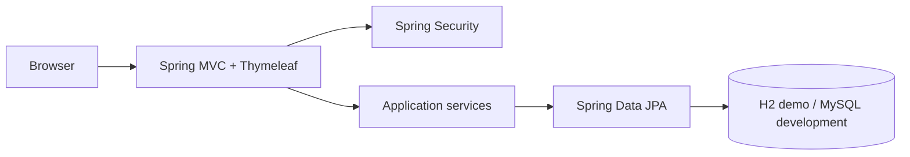

# Learn and Earn

**A coursework learning platform for students and teachers.** Learn and Earn brings course discovery, enrollment and classroom activity into a server-rendered Java application.

`Java` · `Spring Boot` · `Spring Security` · `Spring Data JPA` · `Thymeleaf` · `MySQL / H2`

[Quick start](#local-synthetic-demo) · [Architecture](#architecture) · [Verification](docs/VERIFICATION.md)

## What the project demonstrates

- **Role-based experiences:** student and teacher accounts backed by Spring Security and BCrypt password encoding.
- **Course lifecycle:** source workflows for course creation, discovery and enrollment.
- **Classroom interactions:** lecture, assignment, submission and Q&A models, controllers and views.
- **Layered Java application design:** MVC controllers, service classes and JPA repositories separate HTTP handling from persistence.
- **Self-contained review setup:** a synthetic H2 demo profile replaces dependence on historical external CSV account imports.

These are capabilities represented in the codebase, not a claim that every workflow has passed end-to-end testing. The verification log records the current test status explicitly.

## Architecture



The `demo` profile creates only fictional accounts and a sample course. The normal configuration supports a dedicated MySQL development database without embedding passwords in source.

## Local synthetic demo

Requirements: JDK 11 or later (JDK 17 recommended), internet access for Maven's first dependency download. A global Maven installation is not required.

```sh
sh ./run.sh
```

Windows:

```bat
mvnw.cmd spring-boot:run -Dspring-boot.run.profiles=demo
```

Open **http://localhost:8080**. The demo profile uses an ephemeral H2 database and creates synthetic accounts:

| Role | Email | Local-only password |
| --- | --- | --- |
| Student | student@example.com | LocalDemo123! |
| Teacher | teacher@example.com | LocalDemo123! |

A fictional course is seeded. Try logging in as student, browsing courses, then use the teacher account to explore course management. Data resets on restart. These credentials are deliberately public demonstration values, never production credentials. The server binds to `127.0.0.1` by default.

## MySQL development

Set `DB_URL`, `DB_USER`, and `DB_PASSWORD`, then run without the demo profile:

```sh
# Configure environment variables in your shell; do not commit passwords.
sh ./mvnw spring-boot:run
```

Default URL: `jdbc:mysql://localhost:3306/learnandearn`. Hibernate updates schema in the selected database; use a dedicated disposable development database. `PORT` changes the HTTP port. `SERVER_ADDRESS` controls binding; do not expose this coursework application publicly without a security review.

## Build and tests

```sh
sh ./mvnw test
sh ./mvnw package
```

Tests select the demo profile and assert synthetic student/teacher accounts are seeded. Runtime dependencies are resolved from Maven Central. See [verification notes](docs/VERIFICATION.md) for what was actually checked.

## Structure

- `src/main/java/com/nabil/controllers`: web routes.
- `models`, `repositories`, `services`: JPA entities, persistence and application logic.
- `src/main/resources/templates`: Thymeleaf views.
- `seeder/DemoSeeder.java`: self-contained synthetic local data.
- Other seeders: legacy external CSV importers, disabled by default.

## Limitations and provenance

Legacy seeders fetched external CSV files at application startup. They now require explicit `app.remote-seeding.enabled=true`; leave disabled for demos. Their remote content, ordering and availability are not guaranteed. No external account dataset is imported by the demo.

The original application disables CSRF protection and uses an old Spring Boot line. This is a local portfolio demo, not a secure hosted learning platform. Upload, enrollment, lecture and assignment flows still need manual end-to-end review. Do not use real student data or payment information.

Original contributors, source package names and Git history are retained; this README does not imply sole authorship. Portfolio-readiness edits were prepared in November 2026. Per owner request, new Git commit timestamps may match the previous repository tip and are not the actual editing date.

## Optional container

```sh
docker build -t learn-and-earn-demo .
docker run --rm -p 127.0.0.1:8080:8080 learn-and-earn-demo
```

The build runs tests; the runtime uses the synthetic demo profile. Docker execution has not been verified in the preparation environment.

